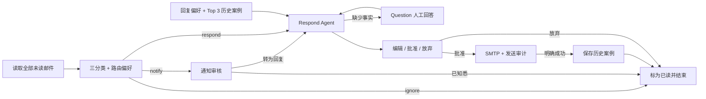

# QQ 邮件助手 MVP

基于 Agent from Scratch 官方示例，适配 QQ IMAP/SMTP 与 Qwen，使用 LangGraph 编排邮件分类、人工审核、历史案例 RAG 和偏好更新。当前面向本地单用户，所有发送固定到测试邮箱。

## 在线体验

[打开邮件 Agent 网页](https://yangz182.github.io/email-agent/)。点击“读取全部邮件”，体验 8 封预置邮件、通知/待回复分区、Question、草稿审核和累计点亮的 Graph。

展示网页独立放在 [site/](site/README.md)，不连接真实邮箱或模型，刷新后重置。Python 业务入口与静态网页分别维护。

## 先读哪些文件

| 位置 | 职责 |
| --- | --- |
| `src/email_assistant/review_app.py` | Streamlit 人工审核入口；输入状态使用 session_state |
| `src/email_assistant/review.py` | 邮件导入、checkpoint 恢复、人工决定与失败重试 |
| `src/email_assistant/email_assistant_hitl.py` | 主 Graph 和 Respond Agent 子图 |
| `src/email_assistant/memory.py` | Markdown 偏好、Chroma 案例、Embedding 与人工确认写入 |
| `src/email_assistant/tools/` | QQ IMAP/SMTP、Question、Done 工具 |
| `src/email_assistant/prompts.py` / `schemas.py` | 当前提示词、输入与状态结构 |
| `tests/` / `evaluation/` | 隔离回归测试 / 固定 30 封模型基线 |
| `site/` / `outputs/` | 展示网页 / 验收证据 |

建议阅读顺序：审核入口 → ReviewService → 主 Graph → 回复子图 → 记忆与邮箱工具。

## 在 Windows PowerShell 中运行

使用项目自己的 `.venv`，按锁文件安装运行和开发依赖：

```powershell
Set-Location D:\projects\agent-from-scratch-MVP
uv sync --extra dev --locked
.\.venv\Scripts\python.exe -X utf8 -m streamlit run .\src\email_assistant\review_app.py --server.address 127.0.0.1 --server.port 8501 --browser.gatherUsageStats false
```

打开 <http://127.0.0.1:8501>。将 `.env.example` 复制为 `.env` 后配置 `DASHSCOPE_API_KEY`、`DASHSCOPE_BASE_URL`、`QWEN_MODEL`、`QQ_EMAIL`、`QQ_EMAIL_AUTH_CODE`，保持 `LANGSMITH_TRACING=false`。不要提交凭据。

更新 Python 业务模块后，在原终端按 `Ctrl+C` 并重新运行启动命令，浏览器刷新可能仍使用进程里已加载的旧模块。

## 工作流程



- 使用 `BODY.PEEK[]` 读取全部未读邮件。单封失败不阻塞后续邮件，待人工处理和失败邮件保持未读。
- `ignore` 自动结束；`notify` 等待知悉或转回复；`respond` 进入回复子图。已完成任务默认隐藏。
- 缺少事实先询问用户，草稿必须经人工确认才发送。实际收件人固定为 `2942397812@qq.com`。
- 同一 UID 复用任务；发送前记录 `attempting`，明确成功后记录 `sent`。结果不明确时阻止自动重发，需要核对邮箱和审计。
- 成功发送才保存 `subject / body / actual_reply` 案例；内容哈希去重，正文超过 2000 字符分块，查询返回 Top 3。历史案例只用于回复。
- 人工分类纠正、问题回答和成功发送的编辑可生成偏好候选；查看差异并单独确认后才写入对应文件，一次性事实不作为长期偏好。
- HTML 邮件转为 Markdown，禁用原始 HTML 执行并移除图片。正文和历史案例作为不可信数据，不能授权发送或自行更新偏好。

## 数据与恢复

| 本地位置 | 内容 |
| --- | --- |
| `data/review-checkpoints.sqlite3` | LangGraph 任务、已提交人工决定和偏好候选确认记录 |
| `data/preferences/triage_preferences.md` | 分类规则 |
| `data/preferences/response_preferences.md` | 回复风格与事实约束 |
| `data/email_rag/` | Chroma 数据库与向量索引，备份需保留整个目录 |
| `.qq-send-log.sqlite3` | UID 发送审计与实际回复，删除会失去防重发保护 |

关闭服务后一起备份这些文件与目录。运行数据已忽略；未提交的草稿与输入属于浏览器会话，可能随新会话丢失，已提交状态以 checkpoint 为准。

Qwen 与 Embedding 共用 DashScope 配置并直连 `trust_env=False`。Embedding 固定使用 `text-embedding-v4`、1024 维；邮件主题、正文、实际回复与检索查询会发送到 DashScope。

## 测试与评测

```powershell
# 离线回归：模型、Embedding、发送及已读操作均使用替身
.\.venv\Scripts\python.exe -X utf8 -m pytest tests -q -p no:cacheprovider --basetemp .test-runtime

# 30 封真实 Qwen 基线：会产生模型费用，邮件操作仍使用替身
.\.venv\Scripts\python.exe -X utf8 .\evaluation\run_evaluation.py

# 仅确定性流程与偏好确认检查
.\.venv\Scripts\python.exe -X utf8 .\evaluation\run_evaluation.py --offline-only
```

完整评测覆盖中英合成邮件 `ignore / notify / respond` 各 10 封，每类中文、英文各 5 封。每封使用独立线程、临时偏好与空 Chroma，运行到首次人工中断或结束，不读取真实邮箱。Question 等待人工回答属于正常暂停。

2026-10-13 的 `qwen-plus` 基线：分类 **22/30（73.33%）**、Macro-F1 **0.708**、首次工具选择 **9/10**；流程检查 **11/11**、反馈检查 **4/4**。7 封通知与 1 封回复请求被误判为忽略，通知召回率为 30%。这是单次小样本基线，尚未衡量 RAG/个性化记忆增益或草稿语义质量。

逐样本证据见 [details.json](evaluation/results/details.json)，分析见 [report.md](evaluation/results/report.md)。每次评测均覆盖这两份文件；`--offline-only` 会将模型指标标为“未运行”。结构清理不覆盖既有基线。

## 验收记录与可选入口

[验收记录](docs/validation.md) 保留真实 QQ 收发、Streamlit 界面、记忆和已读同步证据，以及复验命令。旧 Inbox/Store 的真实发送证据不能直接等同于当前 Streamlit 全链路发送验收。

当前默认只需启动 Streamlit。旧 Agent Server/Inbox 入口 `tools/qq/run_ingest.py`、`langgraph.json` 保留为可选兼容路径，其线程与 Streamlit checkpoint 各自独立；不要混用两套线程状态。
