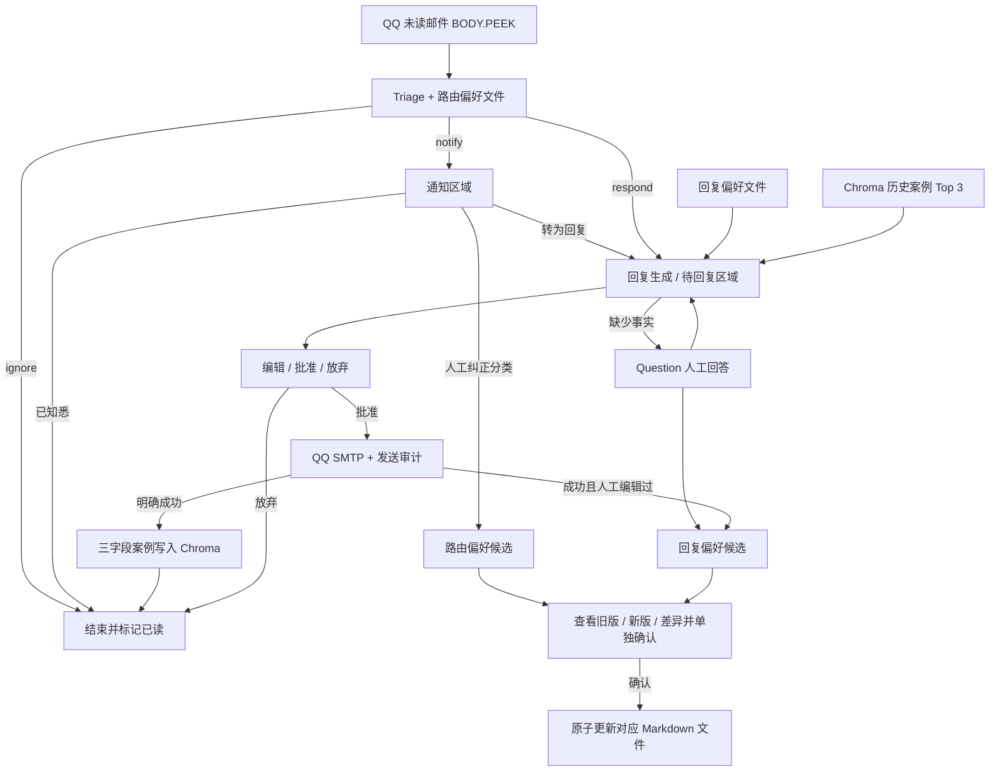

# QQ 邮件助手 MVP

本项目基于 Agent from Scratch 邮件助手示例，使用 QQ IMAP/SMTP、Qwen 与 LangGraph，提供 Streamlit 人工审核、本地历史案例 RAG 和需人工确认的偏好文件。首版面向单用户本地使用。

## 在线项目体验

[打开邮件 Agent 工作流体验](https://email-agent-workflow.spunky-pixie-7158.chatgpt.site)。点击“读取全部邮件”加载 8 封预置邮件，体验通知、回复审核、Question 回路与偏好确认。顶部 Graph 按当前邮件累计点亮执行路径，Respond Agent 以子图边框展示层级。

网页源码位于 `site/dist/`，使用原生 HTML、CSS、JavaScript 和 SVG，无构建依赖；数据仅保留在当前浏览器会话，不连接真实邮箱或模型。可用项目环境启动本地预览：

```powershell
.\.venv\Scripts\python.exe -m http.server 8520 --bind 127.0.0.1 --directory site\dist
```

2026-10-20 桌面浏览器验收：四种路径各两封共 8 封完成；检查重复读取不重复、Question 返回起草、批准前发送节点未点亮、发送后锁定、通知转回复、偏好确认/拒绝、放弃回复及重置。此验收与下方真实 Qwen 分类基线分别记录。

## 工作流程

页面读取收件箱全部未读邮件，使用 `BODY.PEEK[]` 获取正文。`ignore` 自动结束并标记已读，不进入日常列表；`notify` 进入“通知”区域，可确认知悉或转为回复；`respond` 自动进入回复子图，在“待回复”区域回答问题、编辑和批准草稿。已完成任务默认隐藏，可勾选“显示已完成”；未确认偏好和待保存案例仍保留。Qwen 根据当前邮件、回复偏好和 Top 3 历史案例起草；缺少事实时通过 `Question` 提问。用户编辑并批准最终正文后执行 SMTP。只有发送工具明确返回成功才保存历史案例，随后标记已读。候选偏好需另行确认，确认失败保留原文件，已发送邮件和历史案例保持有效。

页面启动时自动继续旧版遗留的 `ignore / respond` 分类确认任务：忽略邮件结束并同步 QQ 已读状态，回复任务继续到问题或草稿审核。点击“读取全部未读邮件”处理本次读取到的未读邮件，一封失败不影响后续邮件；结束后显示本批完成并已读、待人工处理和失败数量。待人工处理及失败邮件保留未读，可在页面完成审核或展开“处理异常”重试。运行期间新收到的邮件在下次读取时处理。

更新 Python 业务模块后，请在运行 Streamlit 的终端按 `Ctrl+C`，再使用下方原命令启动；仅刷新浏览器可能继续使用进程中已加载的旧模块。



测试期间，**实际 SMTP 收件人固定为 `2942397812@qq.com`**，即使草稿显示的是原始发件人。审核说明会展示实际测试收件人；启用其他收件人前，应先在测试邮箱核对收到的邮件。程序在 SMTP 发送前将尝试记录写入 `.qq-send-log.sqlite3`；发送结果不明确时，同一 UID 无法自动重试，需要先核对邮箱和本地日志。

## 在 Windows PowerShell 中运行

使用 `D:\projects\agent-from-scratch-MVP` 中已有的项目 `.venv`。安装锁定依赖后启动审核页面：

```powershell
Set-Location D:\projects\agent-from-scratch-MVP
uv sync --extra dev --locked
.\.venv\Scripts\python.exe -X utf8 -m streamlit run .\src\email_assistant\review_app.py --server.address 127.0.0.1 --server.port 8501 --browser.gatherUsageStats false
```

打开 `http://127.0.0.1:8501`，点击“读取全部未读邮件”，在“通知”或“待回复”区域处理。首次读取时也会继续旧版遗留的 ignore/respond 分类审核任务；notify 仍等待用户处理。按 UID 复用已有任务，重复读取不会重复发送。大量未读邮件会增加分类和起草耗时及模型用量。Streamlit 直接运行现有业务图，使用本地 SQLite checkpoint；此运行方式无需启动 `langgraph dev` 或 Agent Inbox。旧 `run_ingest.py` 仍是 Agent Server 入口，其线程与 Streamlit 的 checkpoint 文件各自独立。

正文使用限高阅读区和可点击链接，原文与分类详情折叠保存。HTML 邮件转换为 Markdown，禁用原始 HTML 执行并移除图片，避免加载远程跟踪图片。显示整理不会修改 Agent 输入或历史案例原文。下拉菜单显示当前区域的已导入任务，数量由分类和完成状态决定，无五封限制。

根目录 `.env` 使用以下配置：`DASHSCOPE_API_KEY`、`DASHSCOPE_BASE_URL`、`QWEN_MODEL`、`LANGSMITH_TRACING=false`、`QQ_EMAIL` 和 `QQ_EMAIL_AUTH_CODE`。请妥善保管该文件，避免公开密钥或邮箱授权码。仅在需要恢复 Python 依赖时运行 `uv sync`。

回复审核中，Question 答案用于继续起草；编辑草稿后需勾选确认并点击 Approve 才发送。Ignore 放弃回复并按终止路径标记已读。路由纠正仅生成路由偏好候选；问题回答和成功发送的人工编辑仅生成回复偏好候选。一次性事实不会被当作长期事实写入偏好。页面显示旧版、新版与差异，确认或拒绝候选可独立操作。

刷新页面或重启 Streamlit 后，任务从 `data/review-checkpoints.sqlite3` 恢复，候选确认/拒绝记录也保存在此文件。草稿编辑、问题答案和按钮状态使用 `st.session_state`；未提交的输入在新浏览器会话中可能丢失，待审核任务及已提交决定以 checkpoint 为准。发送成功后批准按钮锁定；SMTP 结果不明确的 `attempting` 记录阻止自动重发。案例保存失败可单独重试；网络故障、人工拒绝或无效候选均保留当前偏好。

## 本地双记忆与数据边界

| 本地位置 | 用途 |
| --- | --- |
| `data/email_rag/` | Chroma 持久化目录，包含 `chroma.sqlite3` 与向量索引子目录；备份/迁移需复制整个目录 |
| `data/preferences/triage_preferences.md` | `ignore / notify / respond` 路由偏好，缺失时从项目默认规则初始化 |
| `data/preferences/response_preferences.md` | 语气、长度、格式、称呼、事实约束，缺失时从默认回复偏好初始化 |
| `data/review-checkpoints.sqlite3` | LangGraph thread/HITL 状态及候选确认记录；运行时可能同时有 SQLite 辅助文件 |
| `.qq-send-log.sqlite3` | 发送审计及最终实际回复；UID 唯一约束阻止重复发送，成功案例保存失败时可据此恢复 |

两个偏好文件与 Chroma 在本机长期保存，关闭进程后仍有效。LangGraph Store 不再保存运行偏好。删除上述目录/文件会分别丢失对应数据；删除发送审计会失去重复发送保护。停止应用后一起备份这些文件与目录。运行数据已加入 `.gitignore`。

案例业务字段严格为 `subject`、`body`、`actual_reply`。Chroma ID 是三字段内容哈希加 chunk 序号，用于去重；正常邮件为一个 chunk，超过 2000 字符仅切分正文，每段保留完整主题和实际回复。检索取 Top 3，当前查询正文取前 2000 字符。历史案例只进入回复生成提示词，不参与 Triage。

Embedding 固定使用 DashScope `text-embedding-v4`、1024 维，复用现有 `DASHSCOPE_API_KEY`、`DASHSCOPE_BASE_URL`。Qwen 与 Embedding 共用直连 HTTP 配置 `trust_env=False`，解决当前 Windows 系统代理导致的 TLS 断连，系统代理设置保持原值。**生成向量时，邮件主题、正文和实际回复会发送到 DashScope；检索查询也会发送到 DashScope。** Qwen 同样接收邮件与检索案例。发送失败、取消、忽略、仅生成草稿均不写入案例。邮件与案例按不可信数据处理，无法直接修改偏好或授权发送；后端审核关卡与发送审计独立执行这些限制。

## 离线安全检查

```powershell
.\.venv\Scripts\python.exe -X utf8 -m pytest tests -q -p no:cacheprovider --basetemp .test-runtime
```

测试使用模型、Embedding、发送和已读替身，所有偏好、Chroma 和发送审计写入独立临时目录。覆盖三字段案例、长正文切分、去重、跨进程持久化、候选确认门槛、失败保留、提示注入边界、Question 恢复、重复批准与原有发送安全检查。

## MVP 评估

`evaluation/` 复用现有业务图，评估真实 Qwen 的邮件分类与首次工具选择、人工审核流程，以及反馈是否更新用户偏好（preferences）。评估发送和标记已读使用替身，不读取真实邮箱、不进行真实发送，也不写入生产发送日志。无需启动 LangGraph 服务或 Agent Inbox。

从项目根目录使用已有 `.venv` 运行完整评估：

```powershell
Set-Location D:\projects\agent-from-scratch-MVP
.\.venv\Scripts\python.exe -X utf8 .\evaluation\run_evaluation.py
```

完整评估使用根 `.env` 中的 `DASHSCOPE_API_KEY`、`DASHSCOPE_BASE_URL` 和 `QWEN_MODEL`，产生 Qwen 调用费用。评估入口关闭 LangSmith 调用追踪，不输出凭据，不需要升级依赖。每封基线邮件只执行一次，串行运行到首次人工中断或正常结束，不批准发送；运行错误保留在结果中，不选择性重跑。

仅运行确定性流程与反馈检查：

```powershell
Set-Location D:\projects\agent-from-scratch-MVP
.\.venv\Scripts\python.exe -X utf8 .\evaluation\run_evaluation.py --offline-only
```

离线模式使用模型替身，不调用 Qwen；结果中的真实模型指标标为“未运行”。

固定数据集在 `evaluation/dataset.py`：30 封合成邮件，`ignore / notify / respond` 各 10 封，每类中文、英文各 5 封。保留参考项目 16 个邮件场景并按当前 MVP 规则适配，其余补齐促销、重要通知、收件确认、直接提问与正文越权指令场景。每条记录含标准标签、理由和来源，运行时不依赖参考项目。会议和税务通话请求缺少用户排期，预期工具为 `Question`；营销通讯和群发课程推广按当前规则忽略，电话体检提醒按无需邮件答复的通知处理。`respond` 中 6 封信息充分，预期 `send_email_tool`；4 封缺少事实或排期，预期 `Question`。

每封基线邮件使用独立 thread、临时 checkpointer/Store、临时偏好文件与空的临时 Chroma；基线保持原先分类直接路由方式，在首次工具/通知中断处停止。`evaluation/feedback_cases.py` 使用确定性模型替身，检查人工分类纠正仅生成路由候选，编辑/回答仅生成回复候选，确认前文件保持原值，确认后目标文件更新且另一文件保持原值。评测不读取生产双记忆，也不执行真实 Embedding、QQ 发送或已读操作。

每次运行覆盖 `evaluation/results/` 中两个文件，不建立日期子目录：

| 文件 | 内容 |
| --- | --- |
| `details.json` | 环境、模型、数据集与提示词摘要哈希；`baseline` 原始模型输出及模拟操作；`flow_checks` 流程证据；`feedback_checks` 独立人工反馈和更新前后的用户偏好 |
| `report.md` | 中文指标、混淆矩阵、检查通过数、按错误类型总结的失败案例分析与局限 |

分类指标包括正确数 / 30、准确率、各类精确率（precision）、召回率（recall）、F1 分数及宏平均 F1（macro-F1）。执行错误计入准确率分母，混淆矩阵增加 `error` 列。工具选择按标准 `respond` 的 10 封计算达成数 / 10，分类错误导致未进入回复路径也计为失败。报告另列审核前模拟发送与标记已读检查，以及流程和反馈检查的通过数，不合成总分、不预设上线阈值。

混淆矩阵的行表示实际类别（人工标准标签），列表示模型预测结果。“等待人工处理的邮件”指图运行到首次人工中断后暂停的邮件，包含通知审核、回复草稿审核和 `Question` 问询；报告分别列出数量。审核前操作统计仅覆盖这些暂停邮件，`ignore` 路径的模拟已读另见完整明细。报告按错误类型分析现象、模型理由、影响与后续验证方向，逐样本失败记录保留在 `details.json`。

这是小样本单次运行基线。确定性检查验证候选与确认写入机制，真实模型生成偏好的语义质量需另行验证。原有 `evaluation/results/` 基线文件保持历史证据；运行评测会覆盖两个结果文件，指标只适用于该次代码和提示词。评测不进入运行页面。

## 真实环境验收记录（2026-10-02）

以下记录属于旧 Agent Inbox/Store 实现，用于保留历史证据。新 Streamlit 双记忆实现的离线与合成 UI 验收见下方，真实 QQ 发送需要在页面人工批准后核验。

- 使用项目 `.venv` 在 2024 端口启动图服务接口；已有官方 Inbox 使用 `next.cmd` 在 3000 端口启动。
- 真实 QQ 邮件 UID 2585 经 Qwen 分类后，在发送前暂停。暂停时邮件保持未读，发送日志中没有对应尝试记录。
- 通过实际 Inbox 界面编辑并批准回复后，测试邮箱收到且仅收到一封匹配的回复（UID 2587），正文与编辑内容一致。随后 UID 2585 带有 `\\Seen` 已读标记，SQLite 记录状态为 `sent`。
- Store 保存了“使用单句确认，不加问候语或落款”的偏好。新的受控测试邮件 UID 2588 在独立执行线程中生成了 `Received.` 草稿。验收时该草稿处于暂停、未发送状态，保留供检查。
- 官方 Inbox 的 `inbox-item-input.tsx` 需要两行空值兼容修复：使用格式化后的显示值计算文本框行数。此前的 Markdown 兼容修复也予以保留，两项修复均未改变业务图。

截图：[Agent Inbox 中的后续草稿](outputs/qq-memory-inbox.jpg)。这次验收验证了同一运行服务内跨执行线程的记忆使用。跨服务重启的检查点与 Store 恢复仍有未验证项或已知限制；审核期间请保持服务运行。

## Streamlit 合成页面验收

使用项目 `.venv` 和已安装的 Edge 渲染真实 Streamlit 页面，合成邮件、模型和发送替身与生产数据隔离。截图位于 `outputs/review-ui/`。复现时先启动测试页面，再运行浏览器检查脚本：

```powershell
.\.venv\Scripts\python.exe -X utf8 -m streamlit run .\tests\ui_fixture_app.py --server.address 127.0.0.1 --server.port 8502 --server.headless true --browser.gatherUsageStats false
# 另一个终端
.\.venv\Scripts\python.exe -X utf8 .\tests\check_review_browser.py
```

合成页面固定禁用真实邮箱读取及真实 SMTP，用于验证显示和交互。真实 DashScope 合成数据检查见下文；真实 QQ 投递及收到的正文需经人工批准后核验。

2026-10-11 日常分区调整验收：项目 `.venv` 中离线测试 `35 passed`；正文图片处理补充后，相关测试 `17 passed`。真实 Edge 页面逐项验证通知知悉后移除、通知转回复、ignore 不进入列表、限高正文与标题链接、已完成任务显示、Question、草稿编辑、刷新后 checkpoint 恢复、发送失败提示与防重发、成功后批准锁定、处理期间禁用按钮及偏好确认/拒绝。正式页面在 8501 端口实际打开检查；本轮验收未读取、标记或发送真实邮件。

真实 DashScope 合成数据检查已通过：Embedding 写入、内容去重、关闭 Chroma 后重新打开并检索，以及 Qwen 生成回复偏好候选、确认前文件不变、单独确认后落盘。可用以下命令复验（调用 DashScope/Qwen 会产生费用）：

```powershell
.\.venv\Scripts\python.exe -X utf8 .\tests\check_live_memory.py
```

截图：[分类与偏好差异](outputs/review-ui/02-triage-diff.png)、[Question](outputs/review-ui/03-question.png)、[发送错误](outputs/review-ui/05-send-error.png)、[发送成功与偏好候选](outputs/review-ui/06-sent-and-preference.png)、[正式页面](outputs/review-ui/09-production-ready.png)。浏览器检查脚本通过本地 HTTP 提供静态资源，绕过本机 Edge 偶发的 `ERR_NETWORK_CHANGED`；页面与后台的真实 WebSocket 交互保持运行。

本次尚未重新执行真实 QQ 投递验收，也未重跑 30 封真实模型分类基线；原 `evaluation/results/` 两个历史结果文件保留。可在正式页面人工批准一封测试邮件后，核对固定测试邮箱收到的正文、发送审计和新增 Chroma 案例。

2026-10-12 已读同步修复验收：在项目 `.venv` 中离线测试 `38 passed`，实际 Edge 页面通过批次统计和原审核流程检查。重启正式 Streamlit 服务后自动完成 5 封旧版 `ignore` 待确认任务；在正式页面读取另外 2 封未读邮件，均分类为 `ignore` 并完成。QQ 收件箱未读数从 7 降到 0，原 7 封邮件逐封查询 `FLAGS` 均确认含 `\\Seen`。本轮没有批准或发送真实回复，待审批/发送失败保留未读及失败重试由隔离测试验证。截图：[批次统计](outputs/review-ui/11-batch-read-summary.png)、[正式页面处理结果](outputs/review-ui/09-production-ready.png)。
